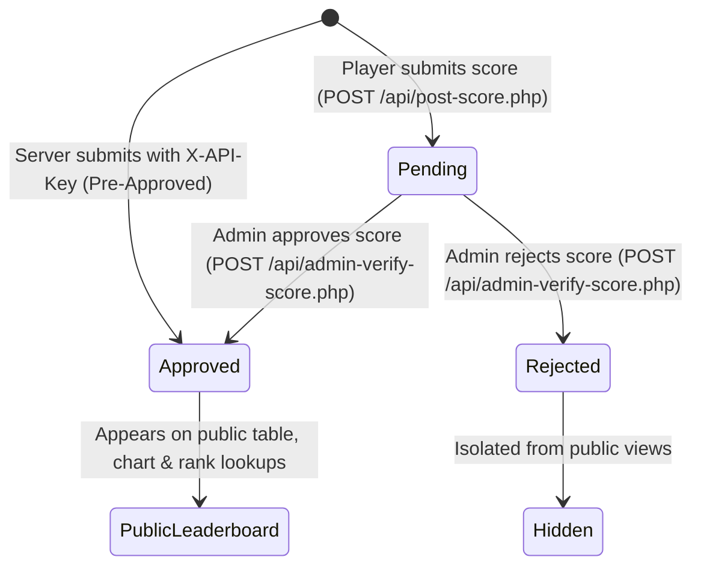

# Game Leaderboard Service (Option A)

A high-performance, modular web application, admin moderation platform, and REST API for tracking and displaying top player scores across multiple games. Built with vanilla HTML5, modern CSS3, vanilla JavaScript (ES6+ `async`/`await`), PHP 8+, and MySQL/MariaDB (optimized for XAMPP and standalone PHP/MySQL environments).

---

## Table of Contents
- [Architecture & Directory Structure](#architecture--directory-structure)
- [Requirements](#requirements)
- [Default Demo Credentials & Roles](#default-demo-credentials--roles)
- [Step-by-Step Setup & Installation](#step-by-step-setup--installation)
- [REST API Documentation](#rest-api-documentation)
  - [Authentication Endpoints](#1-authentication-endpoints)
  - [Public & Player Endpoints](#2-public--player-endpoints)
  - [Admin Moderation Endpoints](#3-admin-moderation-endpoints)
  - [Analytics & Chart API](#4-analytics--chart-api)
- [Bonus & Polish Features (Step 7)](#bonus--polish-features-step-7)
  - [Interactive Canvas Scores-Over-Time Chart](#interactive-canvas-scores-over-time-chart)
  - [Secret API Key Authorization (`X-API-Key`)](#secret-api-key-authorization-x-api-key)
  - [IP & Session Submission Rate Limiting](#ip--session-submission-rate-limiting)
  - [Dark Mode & State Persistence](#dark-mode--state-persistence)
- [Platform Features & Filtration](#platform-features--filtration)
- [Moderation Workflow & Score Verification](#moderation-workflow--score-verification)
- [Challenge Features (Option A)](#challenge-features-option-a)
- [Security & Performance Engineering](#security--performance-engineering)
- [Bug List & Verified Fixes](#bug-list--verified-fixes)
- [Automated Testing Suite](#automated-testing-suite)
- [Client UI & Simulator Pages](#client-ui--simulator-pages)

---

## Architecture & Directory Structure

The project strictly separates presentation, client controllers, business logic, configuration, and data persistence:

```text
.
├── .gitignore                   # Excludes config.php, environment files, IDE & OS artifacts
├── config-example.php           # Template database & API key configuration for handover
├── config.php                   # Local environment credentials (excluded from version control)
├── db.php                       # Reusable singleton PDO database connection layer
├── schema.sql                   # Database definition, tables (users, scores, rate_limits), indexes & seeds
├── index.html                   # Main leaderboard application, filters, canvas chart & auth modal
├── test-simulator.html          # High-volume score generator & edge-case test battery
├── test-e2e.php                 # Automated CLI end-to-end verification test suite (26 tests)
├── css/
│   └── style.css                # Responsive styles, theme variables (light/dark), rank badges & cards
├── js/
│   ├── app.js                   # Main client controller (auth, filters, fetch, XSS-safe DOM)
│   ├── chart.js                 # Vanilla Canvas 2D visualization controller (zero dependencies)
│   └── test-simulator.js        # High-volume simulation & edge-case validation controller
└── api/
    ├── helpers.php              # Centralized JSON responses, session auth, rate limiter & validators
    ├── register.php             # POST: Registers a new user account with bcrypt password hashing
    ├── login.php                # POST: Authenticates user credentials and starts secure session
    ├── logout.php               # POST: Destroys session and clears auth cookies
    ├── session.php              # GET: Returns current user authentication state and role
    ├── get-games.php            # GET: Returns distinct alphabetical list of active games
    ├── get-scores.php           # GET: Filtered public scores (limit, period, search, sort, game)
    ├── get-rank.php             # GET: Returns a specific player's highest score and leaderboard rank
    ├── get-chart-data.php       # GET: Returns daily aggregated stats for canvas trends visualization
    ├── post-score.php           # POST: Submits score (session or X-API-Key required; rate limited)
    ├── admin-pending-scores.php # GET: Admin-only moderation queue with summary statistics
    └── admin-verify-score.php   # POST: Admin-only score moderation (approve/reject single or bulk)
```

---

## Requirements
- **PHP**: 8.0 or newer (with `pdo`, `pdo_mysql`, `curl`, and `session` extensions enabled)
- **Database**: MySQL 8.0+ or MariaDB 10.4+ (default XAMPP or native service)
- **Web Server**: Apache (via XAMPP) or PHP Built-in CLI Server
- **Browser**: Any modern browser (Chrome, Firefox, Safari, Edge)

---

## Default Demo Credentials & Roles

The system comes pre-seeded with two accounts representing the supported user roles:

| Role | Username | Password | Privileges |
|---|---|---|---|
| **Admin** | `admin` | `Admin123!` | Full access: View public leaderboards, submit scores, review pending submissions in the moderation queue, approve/reject single scores, or execute bulk approvals. |
| **Player** | `player1` | `Player123!` | Standard access: View public leaderboards, filter and search scores, look up personal ranking, and submit scores (automatically marked `pending` for admin review). |

> [!TIP]
> The login modal on `index.html` includes one-click "Fill Demo" chips to instantly populate either credential set.

---

## Step-by-Step Setup & Installation

### Step 1: Open the Project Directory
Navigate to the project root directory:
```bash
cd intern
```

### Step 2: Configure Environment Credentials
Copy `config-example.php` to `config.php`:
```bash
# Windows PowerShell
Copy-Item config-example.php config.php

# Unix / macOS
cp config-example.php config.php
```

Verify your local database settings in `config.php`. The default configuration is tailored for XAMPP:
```php
define('DB_HOST', '127.0.0.1');
define('DB_NAME', 'game_leaderboard');
define('DB_USER', 'root');
define('DB_PASS', '');            // Empty string for default XAMPP, or your MySQL root password
define('DB_CHARSET', 'utf8mb4');
define('API_SECRET_KEY', 'wolves-secret-key-2026');
```

### Step 3: Import Database Schema & Seed Data
Execute `schema.sql` to initialize the database, tables (`users`, `scores`, `rate_limits`), composite indexes, and demo seed data:

**Default XAMPP (blank password):**
```bash
mysql -u root < schema.sql
```

**Password-protected MySQL instance:**
```bash
mysql -u root -p < schema.sql
```

### Step 4: Run the Web Server

#### Option A: PHP Built-in Server (Recommended for Fast Local Testing)
Run the following in the project root:
```bash
php -S 127.0.0.1:8000
```
Open your browser and navigate to:
- Main Platform: [http://127.0.0.1:8000/](http://127.0.0.1:8000/)
- 100 Random Scores Simulator: [http://127.0.0.1:8000/test-simulator.html](http://127.0.0.1:8000/test-simulator.html)

#### Option B: XAMPP Apache
1. Copy or symlink the project folder into your XAMPP `htdocs` directory (e.g. `C:\xampp\htdocs\intern`).
2. Start Apache and MySQL from the **XAMPP Control Panel**.
3. Navigate to: `http://localhost/intern/`

---

## REST API Documentation

All API endpoints strictly return standard JSON with UTF-8 encoding and appropriate HTTP status codes.

### 1. Authentication Endpoints

#### Register Account
- **URL**: `/api/register.php`
- **Method**: `POST`
- **Headers**: `Content-Type: application/json`
- **Body**:
  ```json
  {
      "username": "SpeedRunner99",
      "password": "Password123!"
  }
  ```
- **Responses**:
  - `201 Created`: User created and session started.
  - `400 Bad Request`: Validation failure (username 3–50 alphanumeric/underscore, password min 6 chars).
  - `409 Conflict`: Username already taken.

#### Login
- **URL**: `/api/login.php`
- **Method**: `POST`
- **Headers**: `Content-Type: application/json`
- **Body**:
  ```json
  {
      "username": "player1",
      "password": "Player123!"
  }
  ```
- **Responses**:
  - `200 OK`: Credentials verified, returns `{ status: "success", user: { id, username, role } }`.
  - `401 Unauthorized`: Invalid username or password.

#### Logout
- **URL**: `/api/logout.php`
- **Method**: `POST`
- **Responses**:
  - `200 OK`: Destroys session and unsets session cookie.

#### Session Status
- **URL**: `/api/session.php`
- **Method**: `GET`
- **Responses**:
  - `200 OK`:
    ```json
    {
        "status": "success",
        "authenticated": true,
        "user": {
            "id": 2,
            "username": "player1",
            "role": "player"
        }
    }
    ```

---

### 2. Public & Player Endpoints

#### Get Games List
- **URL**: `/api/get-games.php`
- **Method**: `GET`
- **Description**: Returns an alphabetical list of all distinct games with approved scores recorded.
- **Response (`200 OK`)**:
  ```json
  {
      "status": "success",
      "games": ["Drift King", "Dungeon Runner", "Space Blaster"]
  }
  ```

#### Get Filtered Leaderboard Scores
- **URL**: `/api/get-scores.php`
- **Method**: `GET`
- **Query Parameters**:
  - `game` *(string, optional, default: `all`)*: Target game title or `all` for cross-game view.
  - `limit` *(string/int, optional, default: `10`)*: Number of rows: `10`, `15`, `25`, `50`, or `all`.
  - `period` *(string, optional, default: `all`)*: Timeframe: `all`, `week`, or `today`.
  - `sort` *(string, optional, default: `score_desc`)*: Sort order: `score_desc`, `score_asc`, or `newest`.
  - `search` *(string, optional)*: Case-insensitive substring match for player name.
- **Description**: Retrieves approved leaderboard entries satisfying all active filters.
- **Response (`200 OK`)**:
  ```json
  {
      "status": "success",
      "game": "Space Blaster",
      "period": "all",
      "limit": "15",
      "sort": "score_desc",
      "search": null,
      "scores": [
          {
              "id": 1,
              "game": "Space Blaster",
              "player_name": "AcePilot",
              "score": 9850,
              "created_at": "2026-11-10 09:40:06"
          }
      ]
  }
  ```

#### Player Rank Lookup
- **URL**: `/api/get-rank.php`
- **Method**: `GET`
- **Query Parameters**:
  - `game` *(string, required)*: Game title.
  - `player_name` *(string, required)*: Player username.
  - `period` *(string, optional, default: `all`)*: `all`, `week`, or `today`.
- **Response (`200 OK`)**:
  ```json
  {
      "status": "success",
      "found": true,
      "game": "Space Blaster",
      "period": "all",
      "player_name": "AcePilot",
      "best_score": 9850,
      "rank": 1,
      "attempts": 1
  }
  ```

#### Submit Score
- **URL**: `/api/post-score.php`
- **Method**: `POST`
- **Headers**:
  - `Content-Type: application/json`
  - `X-API-Key: wolves-secret-key-2026` *(optional: direct server key)*
- **Body Payload**:
  ```json
  {
      "game": "Space Blaster",
      "player_name": "SpeedRunner",
      "score": 10500
  }
  ```
- **Requirements**: User must either be authenticated via session OR provide a valid `X-API-Key` header (or `api_key` payload field).
- **Rate Limit**: Maximum 10 submissions per minute per IP. Exceeding returns `429 Too Many Requests`.
- **Response (`201 Created`)**:
  ```json
  {
      "status": "success",
      "message": "Score submitted successfully.",
      "data": {
          "id": 25,
          "game": "Space Blaster",
          "player_name": "SpeedRunner",
          "score": 10500,
          "status": "approved"
      }
  }
  ```

---

### 3. Admin Moderation Endpoints

#### View Moderation Queue
- **URL**: `/api/admin-pending-scores.php`
- **Method**: `GET`
- **Requirements**: Authenticated user with `role === 'admin'` (`403 Forbidden` for players).
- **Query Parameters**:
  - `status` *(string, optional, default: `pending`)*: Filter by `pending`, `approved`, `rejected`, or `all`.
  - `game` *(string, optional)*: Filter queue by specific game.
- **Response (`200 OK`)**:
  ```json
  {
      "status": "success",
      "summary": {
          "pending": 4,
          "approved": 20,
          "rejected": 0,
          "total": 24
      },
      "scores": [
          {
              "id": 21,
              "user_id": 2,
              "submitter_username": "player1",
              "player_name": "NovaStrike",
              "game": "Space Blaster",
              "score": 12500,
              "status": "pending",
              "created_at": "2026-11-10 09:20:00"
          }
      ]
  }
  ```

#### Verify / Moderate Score
- **URL**: `/api/admin-verify-score.php`
- **Method**: `POST`
- **Requirements**: Authenticated user with `role === 'admin'`.
- **Body Options**:
  - **Single Action**:
    ```json
    { "score_id": 21, "action": "approve" }
    ```
    *(Allowed actions: `approve`, `reject`)*
  - **Bulk Action**:
    ```json
    { "action": "approve_all_pending", "game": "Space Blaster" }
    ```
    *(Allowed actions: `approve_all_pending`, `reject_all_pending`)*
- **Response (`200 OK`)**:
  ```json
  {
      "status": "success",
      "message": "Score approved successfully."
  }
  ```

---

### 4. Analytics & Chart API

#### Scores Over Time Aggregation
- **URL**: `/api/get-chart-data.php`
- **Method**: `GET`
- **Query Parameters**:
  - `game` *(string, required)*: Game title or `all` for cross-game analytics.
  - `days` *(int, optional, default: `30`)*: Aggregation timeframe (`7`, `30`, or `90`).
- **Description**: Returns daily chronological snapshots aggregating the highest score, total submissions, and average score strictly across approved entries.
- **Response (`200 OK`)**:
  ```json
  {
      "status": "success",
      "game": "Space Blaster",
      "days": 30,
      "data": [
          {
              "date_point": "2026-11-06",
              "highest_score": 8350,
              "total_submissions": 2,
              "average_score": 7500
          },
          {
              "date_point": "2026-11-10",
              "highest_score": 9850,
              "total_submissions": 5,
              "average_score": 8420
          }
      ]
  }
  ```

---

## Bonus & Polish Features (Step 7)

### Interactive Canvas Scores-Over-Time Chart
- **Lightweight Vanilla Canvas 2D Engine ([js/chart.js](file:///c:/Users/Ihab-pc/Desktop/intern/js/chart.js))**:
  - Zero heavy external libraries or CDN dependencies.
  - High-DPI / Retina display crispness via dynamic `devicePixelRatio` scaling.
  - Smooth Bezier curves, subtle background grid lines, and soft gradient area fill.
  - Interactive hover detection with glowing nodes, vertical guide line, and responsive floating tooltips.
  - Toggle between **Highest Score**, **Average Score**, and **Total Submissions**.
  - Toggle between **7 Days**, **30 Days**, and **90 Days** snapshots.
  - Seamlessly re-renders when games change, after admin moderation approvals, or when switching between Dark and Light mode.

### Secret API Key Authorization (`X-API-Key`)
- Direct game client and server-to-server integration:
  - Submit scores by sending the `X-API-Key` HTTP header (or `api_key` payload parameter).
  - Validated using timing-safe comparison (`hash_equals()`) against `API_SECRET_KEY` in `config.php`.
  - Submissions authenticated via a valid Secret API Key are **pre-approved** immediately and allow specifying custom player handles.
  - Requests lacking both a session and a valid API key return HTTP `401 Unauthorized`.

### IP & Session Submission Rate Limiting
- **Protection Against Spam & Flooding**:
  - Enforces a ceiling of **10 score submissions per minute** per client IP on `/api/post-score.php`.
  - Backed by the lightweight MySQL table `rate_limits (ip_address, endpoint, hit_count, window_start)`.
  - Exceeding the rate limit immediately returns HTTP `429 Too Many Requests` with a standard `Retry-After: <seconds>` header and a clear descriptive JSON message.

### Dark Mode & State Persistence
- **Theme Toggle**:
  - Seamless toggle button (`#themeToggle`) with sun/moon indicators.
  - Refactored CSS custom properties (`--bg-primary`, `--bg-surface`, `--text-primary`, `--text-secondary`, `--border-color`, `--accent-color`, `--card-shadow`).
  - High-contrast, accessibility-tested dark mode and crisp modern light mode styling.
- **LocalStorage State Caching**:
  - Persists the user's active theme across browser sessions (`theme` key).
  - Falls back smoothly to system preference (`prefers-color-scheme`).
  - Caches user filter preferences (`selectedGame`, `leaderboard_limit`, `leaderboard_sort`, `leaderboard_period`) so their preferred view is preserved on page reload.

---

## Platform Features & Filtration

The application provides a comprehensive filtration control deck:

1. **Game Selector**:
   - Dynamic game dropdown fetched from `/api/get-games.php`.
   - Special **"All Games"** option displaying cross-game scores with a dedicated "Game" column in the table.
2. **Display Limit**:
   - Segmented buttons for **Top 10**, **Top 15**, **Top 25**, **Top 50**, and **All** (up to 500 records).
3. **Timeframe Filter**:
   - **All-Time**: Global historical scores.
   - **This Week**: Scores logged within the past 7 days (`created_at >= DATE_SUB(CURDATE(), INTERVAL 7 DAY)`).
   - **Today**: Scores logged today (`created_at >= CURDATE()`).
4. **Sort Ordering**:
   - **Highest Score (Default)**: `score DESC, created_at ASC`.
   - **Lowest Score**: `score ASC, created_at ASC` (ideal for time-trial or golf scoring).
   - **Newest First**: `created_at DESC, score DESC`.
5. **Real-time Player Search**:
   - Debounced search input that queries matching player handles without requiring a page reload.

---

## Moderation Workflow & Score Verification

To ensure leaderboard integrity, scores follow a strict lifecycle:



1. **Submission**: Authenticated players submit their score. The score is assigned `status = 'pending'`.
2. **Isolation**: The public API (`/api/get-scores.php`, `/api/get-chart-data.php`, and `/api/get-rank.php`) strictly filters `WHERE status = 'approved'`. Pending submissions cannot alter public rankings, podiums, or charts.
3. **Admin Queue**: When an admin logs in, an **Admin Verification Queue** card appears dynamically above the leaderboard:
   - Displays real-time counts of pending submissions.
   - Shows submitter account, game, score, and submission timestamp.
   - Provides single-click **Approve** and **Reject** buttons per submission.
   - Provides a **Bulk Approve All Pending** button.
4. **Instant Update**: Approving a score immediately moves it to the approved pool, and the active leaderboard and canvas chart automatically refresh.

---

## Challenge Features (Option A)

### Challenge 1: Time-Range Filters (Today, This Week, All-Time)
- **Index-Optimized Queries**: Avoids table-scanning wrapper functions (e.g. `DATE(created_at)`), using range comparisons (`created_at >= CURDATE()`) backed by composite index `idx_status_game_created_score`.

### Challenge 2: Player's Own Rank Lookup
- Computes `MAX(score)` for personal best, `COUNT(*)` for total attempts, and `COUNT(*) + 1 WHERE score > :best_score` for relative leaderboard position, strictly evaluated across approved scores.

### Challenge 3: 100 Random Scores Test Page
- High-volume simulator at [test-simulator.html](file:///c:/Users/Ihab-pc/Desktop/intern/test-simulator.html):
  - Sends 100 randomized scores with live progress, success/failure metrics, and latency counters.
  - Automatically respects user session status or uses the Secret API Key toggle.
  - Includes a 13-case automated out-of-range & validation test battery.

---

## Security & Performance Engineering

1. **API Key Security**:
   - Compares secret API keys with timing-safe `hash_equals()`. Secret keys are configured in `config.php` (git-ignored).
2. **Rate Limiting Protection**:
   - Enforces 10 submissions/minute per IP, returning standard HTTP 429 and `Retry-After` headers.
3. **Password Security**:
   - Passwords hashed using `password_hash($password, PASSWORD_DEFAULT)` (Bcrypt) and verified using timing-safe `password_verify()`.
4. **Session Security**:
   - Custom session parameters configured in `startSecureSession()`: `cookie_httponly = true`, `cookie_samesite = 'Lax'`, and strict mode enabled.
5. **Cross-Site Scripting (XSS) Immunity**:
   - Zero `innerHTML` for dynamic content. All usernames, game titles, chart labels, and status strings are rendered strictly via `document.createElement()`, `textContent`, and Canvas 2D text primitives.
6. **SQL Injection Prevention**:
   - 100% of queries use PDO prepared statements with bound parameters. Zero queries inside loops.
7. **Signed 32-bit Integer Bound Enforcement**:
   - Prevents MySQL numeric overflow (`SQLSTATE 22003`) by validating inputs against `MAX_SCORE = 2147483647` before SQL execution.
8. **Optimized Composite Indexes**:
   - `idx_user_id`: Fast join between `users` and `scores`.
   - `idx_status_game_created_score` on `(status, game, created_at, score DESC)`: Covers filtered leaderboard queries without extra table scans.
   - `idx_status_created_score` on `(status, created_at, score DESC)`: Covers cross-game leaderboard queries.

---

## Bug List & Verified Fixes

| Issue / Edge Case | Root Cause / Vulnerability | Solution / Fix Implemented |
|---|---|---|
| **Numeric Out of Range** (`score > 2147483647`) | MySQL signed 32-bit `INT` maximum is 2,147,483,647. Values like `2147483648` or `999999999999999999999999` trigger SQLSTATE `22003` crash. | In `api/helpers.php`, raw scores are checked for digit length and compared against `2147483647` without integer overflow risks, returning HTTP 400. In `api/post-score.php`, PDO catches SQLSTATE `22003` as a graceful fallback. |
| **Zero Score Rejection** (`score: 0` or `"0"`) | Standard PHP `empty($score)` evaluates `0` and `"0"` as empty, improperly rejecting valid scores of zero. | Replaced loose checks with `!isset($input['score']) \|\| (is_string($input['score']) && trim($input['score']) === '')` in `api/helpers.php`. |
| **Float/Decimal Score Permissibility** | Numeric strings with decimals (e.g. `12.34`) or float literals could bypass loose numeric checks. | Added explicit `is_float($input['score'])` guard and `ctype_digit` string validation to enforce integer-only scores. |
| **Whitespace-Only Inputs** | Inputs like `"   "` pass `isset()` and `!== ''` checks if not trimmed. | Added `trim()` validation for `player_name` and `game` to reject whitespace-only submissions with HTTP 400. |
| **Oversized String Payloads** | Payloads exceeding database column width (100 characters) could trigger unhandled database truncation errors. | Enforced string length validation (`mb_strlen(trim(...)) <= 100`) returning HTTP 400. |
| **Submission Flooding & DoS** | Malicious users or compromised clients could hammer `/api/post-score.php` with thousands of score inserts. | Implemented IP/session rate limiter returning HTTP `429 Too Many Requests` with `Retry-After` header when exceeding 10 requests per minute. |
| **Unapproved Scores on Leaderboard** | Submitting unverified scores directly into public rankings allows cheating or vulgar submissions. | Implemented moderation pipeline with `status = 'pending'`, restricting public views strictly to `status = 'approved'`. |
| **Player Impersonation** | Submitting scores with arbitrary `player_name` values could allow spoofing other players' scores. | Enforced session check in `api/post-score.php` locking score submission to the authenticated user's username (unless admin or trusted API key). |
| **Privilege Escalation on Moderation API** | Insecure direct object reference or missing role checks could let normal players approve their own scores. | Enforced server-side `requireAdmin()` check returning HTTP 403 Forbidden for non-admin accounts. |
| **XSS Payload Injection** | User handles containing HTML/JS tags (e.g. `<script>alert(1)</script>`) could execute if rendered via `innerHTML`. | Strictly used `document.createElement()` and `textContent` across all client scripts to ensure tags are rendered safely as plain text. |

---

## Automated Testing Suite

The repository includes a comprehensive CLI end-to-end test suite (`test-e2e.php`) verifying all platform capabilities against the live HTTP server:

```bash
php test-e2e.php
```

### Verified Test Cases (26/26 PASS):
1. Initial unauthenticated session check (`GET /api/session.php`).
2. Unauthenticated score submission rejection (`401 Unauthorized`).
3. Password validation on registration (`< 6 characters` returns `400 Bad Request`).
4. Duplicate username conflict prevention (`409 Conflict`).
5. Valid player registration and immediate session initiation (`201 Created`).
6. Session persistence verification for registered user.
7. Player score submission marked as `pending` (`201 Created`).
8. Verification that pending score does NOT appear on the public leaderboard.
9. Player attempt to access admin moderation blocked (`403 Forbidden`).
10. User logout and session destruction verification.
11. Invalid login credentials rejection (`401 Unauthorized`).
12. Admin login verification and admin role check (`200 OK`).
13. Admin moderation queue listing pending score.
14. Admin score approval (`200 OK`).
15. Verification that approved score is now visible on public leaderboard.
16. Player rank lookup accuracy against approved scores.
17. Full limit filtration (`10`, `15`, `25`, `all`).
18. Multi-directional sort ordering (`score_desc`, `score_asc`, `newest`).
19. Real-time player search matching.
20. Cross-game view (`game=all`) with multi-game row attribution.
21. Secret API Key: Invalid key without session returns HTTP 401.
22. Secret API Key: Valid key allows submission with pre-approval (HTTP 201).
23. Chart Analytics API: Valid game and days returns chronological daily snapshots (`GET /api/get-chart-data.php`).
24. Chart Analytics API: `game=all` returns cross-game aggregations.
25. Chart Analytics API: Missing game parameter returns HTTP 400.
26. Submission Rate Limiting: Exceeding 10 submissions per minute triggers HTTP 429 Too Many Requests with `Retry-After`.

---

## Client UI & Simulator Pages

- **Main Leaderboard ([index.html](file:///c:/Users/Ihab-pc/Desktop/intern/index.html))**:
  - Live session header with user status badge, Login/Register modal button, or Logout button.
  - Theme Toggle button (`#themeToggle`) for switching between Dark and Light modes.
  - Quick-fill demo credentials chips (`Admin Demo`, `Player Demo`).
  - Interactive Admin Moderation Dashboard (rendered exclusively for admin sessions).
  - Multi-dimensional Filtration Deck (Game, Limit, Sort, Search, Timeframe).
  - Interactive HTML5 Canvas Analytics Chart ([js/chart.js](file:///c:/Users/Ihab-pc/Desktop/intern/js/chart.js)) showing daily trends with hover tooltips and metric switcher.
  - Top 3 Podium Accents: Gold (#1), Silver (#2), Bronze (#3).
  - Player Rank Lookup card with personal best, current rank, and submission counter.
  - Authenticated Score Submission Form with live validation and input bounds protection.
  - Fully responsive design on desktop, tablet, and narrow mobile viewports down to 375px.

- **High-Volume Traffic Simulator ([test-simulator.html](file:///c:/Users/Ihab-pc/Desktop/intern/test-simulator.html))**:
  - Batch generation of 100 randomized scores (`0` to `950,000`).
  - Built-in Secret API Key toggle (`wolves-secret-key-2026`) for direct server-to-server stress testing.
  - 13-case automated out-of-range and malicious payload test battery.
  - Real-time progress bar, success/error counters, and network latency instrumentation.
  - Live stream log table.
